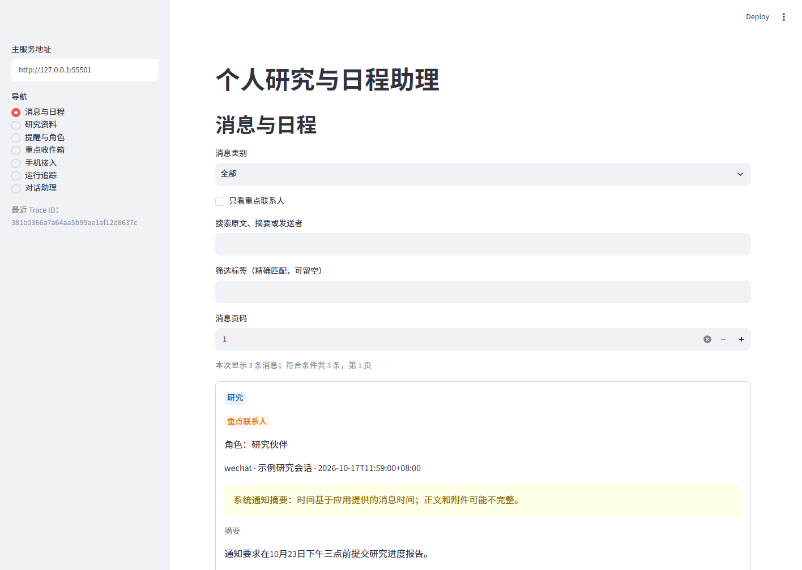
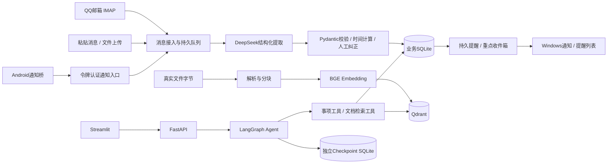

# 个人研究与日程智能助理

[](https://github.com/notzjy/student-research-assistant/actions/workflows/tests.yml)

基于 [agent-service-toolkit](https://github.com/JoshuaC215/agent-service-toolkit) 扩展的个人 Agent 应用：把重要消息、研究资料和待办提醒集中到一个本地平台，保留原文、出处与人工纠正记录。

**技术栈：** Python · LangGraph · LangChain · DeepSeek · FastAPI · Pydantic · SQLite · BGE Embedding · Qdrant · Streamlit · Android Java

[运行说明](docs/DELIVERY.md) · [简历项目介绍](docs/RESUME_PROJECT.md) · [验收报告](docs/results/final_delivery.json) · [安卓无线接入](docs/CHANNEL_INTEGRATION.md) · [上游声明](THIRD_PARTY_NOTICES.md)

项目仓库：[https://github.com/notzjy/student-research-assistant](https://github.com/notzjy/student-research-assistant)。可将此链接用于简历；上传与校验详情见[发布记录](docs/PUBLICATION.md)。



## 解决什么问题

研究、学生生活与求职消息分散在多个应用中，文件容易漏整理，时间与地点需要反复查找。本项目将消息提取为有证据的结构化信息，由用户确定重点联系人和提醒规则，再用程序执行分类、查询、提醒与检索。

## 已实现的功能

- **消息接入与分类：** QQ邮箱只读IMAP（新信优先，历史继续补齐）、直接粘贴、完整JSON导入；按研究、学生生活、求职和其他分类，支持多标签、搜索分页、去重与版本化人工纠正。
- **重点联系人：** 按来源、账号与发送者标识配置角色；独立重点收件箱、新消息到达提醒与显式已读，不凭昵称猜测身份。
- **时间与提醒：** 提取截止时间、活动时段与地点；按原消息时间解释相对日期，日期不补钟点；持久提醒队列支持重启恢复、有限重试、修改重排，以及已完成和已取消状态。
- **研究资料RAG：** txt、Markdown、含文本PDF解析和分块，本地BGE中文Embedding＋Qdrant向量检索，DeepSeek带出处回答；支持正文分类、证据引用、原件下载和人工纠正。
- **Agent对话：** LangGraph编排模型与工具，支持事项查询、保存、完成及资料检索；thread_id与独立SQLite Checkpoint保存会话上下文。
- **本地操作界面：** 七页Streamlit界面、Windows通知与提醒列表、一键启停、Trace追踪和固定消息语义评测。
- **安卓无线通知桥：** 已构建APK，通知先进入手机SQLite队列再通过网络上传，支持断线缓存、重连补传与来源去重；日常使用不依赖USB。

## 架构



## 快速开始

主要验收环境为 **Windows＋Python 3.13**，后端默认端口8002，界面默认8501。此入口启动的是`student`服务配置，不要求运行上游全量demo。

```powershell
git clone https://github.com/notzjy/student-research-assistant.git
cd student-research-assistant

# 在仓库根目录创建环境并安装锁定依赖
py -3.13 -m venv .venv
.\.venv\Scripts\python.exe -m pip install -r requirements.lock.txt
Copy-Item .env.example .env
```

在本机编辑`.env`，填写模型平台的`COMPATIBLE_API_KEY`；按实际平台确认`COMPATIBLE_BASE_URL`与`COMPATIBLE_MODEL`。凭证不要提交到Git。QQ邮箱是可选入口，可运行`configure_mail.py`在本机配置IMAP授权码。

```powershell
# 检查环境，不请求模型或邮箱
.\.venv\Scripts\python.exe -X utf8 .\start_assistant.py --check

# 打开启动控制台
.\启动助理.cmd
```

在控制台点击“启动助理”，准备完成后浏览器打开`http://127.0.0.1:8501`。需要手机接入时，启动前勾选局域网选项，再在“手机接入”页下载安装和配对。服务停止时电脑不会即时提醒，手机可先缓存通知。

第一次建立文档索引需要下载本地Embedding模型。具体配置、数据备份、端口占用处理与七个页面操作见[交付说明](docs/DELIVERY.md)。

## 验证结果与能力边界

以下为 **2026-10-17** 的验收记录，测试通过不代表所有生产消息都能正确理解。

| 验证范围 | 结果与证据 |
|---|---|
| 自动化回归 | 本机与[GitHub Actions](https://github.com/notzjy/student-research-assistant/actions/runs/39026274490)均确认350项通过：根测试277＋保留教学脚本73，依赖检查通过 |
| 实际本机联调 | 29项通过：真实DeepSeek、BGE512、Qdrant、HTTP、Streamlit、Edge、一键启动器与重启持久性；业务样本为合成数据，见[报告](docs/results/final_delivery.json) |
| QQ邮箱 | 已实际读取正文和真实PDF，完成正文分类、检索问答、指定UID恢复、去重与重启验收，见[附件验收](docs/results/qq_attachment_acceptance.json)；真正新信到通知延迟仍待验 |
| Android | APK实际构建、对齐、签名与哈希核对通过；尚未真机安装、授权或验收微信/QQ/BOSS通知，见[构建记录](android-notification-bridge/dist/build_result.json) |
| Docker | GitHub Linux运行器已实际构建镜像、启动Compose后端与界面并验证重启持久性；本机Windows仍无Docker CLI |

通知桥仅取得应用实际展示的通知内容，不保证完整聊天、原消息时刻、稳定真实联系人ID或附件原件。手机与电脑默认在同一可互通网络使用；跨网HTTPS接收端尚未部署。模型推断和引用出处校验不保证语义永远正确，保留人工纠正入口。

原件归档支持任意格式单件≤25MB；正文解析与RAG仅支持txt、md、含文本PDF单件≤10MB，无OCR、Word解析或Reranker。Qdrant local按单后端进程使用。Windows通知`submitted`只代表已交给通道，不代表已读或严格只显示一次。

## 测试

```powershell
.\.venv\Scripts\python.exe -m unittest discover -s tests -q
.\.venv\Scripts\python.exe -m unittest discover -s lessons -q
.\.venv\Scripts\python.exe -m pip check
```

根目录GitHub Actions工作流执行离线回归，不需要模型密钥或QQ授权码。首次Windows远端运行已确认337项通过；最新350项回归及实际容器验收见[收尾报告](docs/results/closeout_status.json)和对应Actions记录。

## 代码导航

| 位置 | 职责 |
|---|---|
| `agent-service-toolkit/src/student_assistant/` | 正式Agent、服务、消息、文件RAG、提醒、通知桥与Trace |
| `run_assistant.py` / `assistant_client.py` | 后端入口与CLI客户端 |
| `assistant_dashboard.py` / `dashboard_*.py` | 七页本地界面、HTTP适配与表单 |
| `start_assistant.py` / `启动助理.cmd` | 只管理自有进程的一键启停 |
| `android-notification-bridge/` | 安卓通知桥源码、构建脚本和安装包 |
| `tests/` | 正式功能回归测试 |
| `examples/` | 不含真实私人消息的导入示例 |
| `lessons/` | 保留的学习脚本，正式服务复用其中基础配置与公共组件 |
| `docs/` | 使用说明、简历介绍、验收记录、时间规则与学习记录 |

## 来源与开发说明

本项目扩展自MIT许可的`agent-service-toolkit`固定快照，保留上游许可证与来源记录；个人助理业务代码、界面及安卓通知桥为本仓库扩展内容。详见[第三方声明](THIRD_PARTY_NOTICES.md)与[上游来源](docs/UPSTREAM.md)。

项目在AI辅助下迭代开发，开发记录与技术栈学习记录单独保留；工程交付不等于个人已掌握全部技术。[简历项目介绍](docs/RESUME_PROJECT.md)沿用现有简历项目段落结构，仅陈述本项目已有证据的能力。[历史开发记录](docs/DEVELOPMENT_HISTORY.md)与[后续学习地图](docs/POST_PROJECT_LEARNING.md)不作为当前功能已验收的替代证据。

模型密钥、QQ授权码、真实邮件、业务数据库、附件原件、模型缓存和签名私钥均保留本地，不随公开仓库上传。
