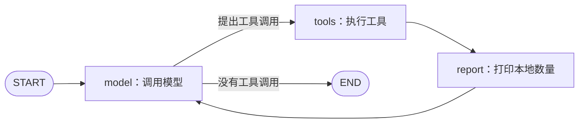

# 第四课：LangGraph 的状态、节点与条件边

## 这次怎样接回已有项目

第三课用 Python 手写一轮工具执行。第四课继续使用同一个 `save_task` 与 JSON 文件，由 LangGraph 决定下一步执行模型、工具还是结束。



这个图允许模型根据工具结果继续提出调用，直到输出最终答复或达到执行步数上限。它是后续加入分类、人工确认、保存等步骤的基础。

## 先运行

根目录 `.venv` 已安装 `langgraph==1.2.11`，版本与本地上游 `uv.lock` 的 LangGraph 主包一致。环境已通过依赖检查；无需重复安装完整工具包。

在 `D:\Student_Assistant` 的 PowerShell 中：

```powershell
.\.venv\Scripts\python.exe .\lessons\04_langgraph.py
```

2026-10-15 初次真实记录为 `model → tools → model`，见 [results/04_example.json](results/04_example.json)。用户随后已加入report节点；当前源码路径为 `model → tools → report → model`，并在第五课真实HTTP请求中验证，见 [results/05_example.json](results/05_example.json)。report不增加对话消息，默认仍保留6条。

只查看实际图结构，不调用模型和工具：

```powershell
.\.venv\Scripts\python.exe .\lessons\04_langgraph.py --preview
```

只查看待办：

```powershell
.\.venv\Scripts\python.exe .\lessons\04_langgraph.py --list
```

继续复用 `local-data/lesson03_tasks.json`；本课图执行记录另存到 `local-data/lesson04_trace.json`。

## 三个核心概念都在哪里

| 概念 | 本课代码 | 实际作用 |
| --- | --- | --- |
| State 状态 | `AssistantState(MessagesState)` | 各节点共享对话消息与执行顺序。 |
| Node 节点 | `call_model`、`call_tools` | 普通 Python 函数；分别负责请求模型和执行工具。 |
| Edge 边 | `add_edge(...)` | 指定固定的下一步。 |
| 条件边 | `add_conditional_edges(...)` | 根据模型有没有工具调用，选择执行工具或结束。 |
| 编译 | `builder.compile()` | 将定义好的节点与边生成可执行图。 |
| 执行 | `agent.invoke(...)` | 传入初始状态，沿图运行并返回最终状态。 |

关键连接代码：

```python
builder = StateGraph(AssistantState)
builder.add_node("model", call_model)
builder.add_node("tools", call_tools)
builder.add_edge(START, "model")
builder.add_conditional_edges("model", route_after_model, {"tools": "tools", END: END})
builder.add_edge("tools", "model")
```

`route_after_model` 直接检查最后一条模型消息的 `tool_calls`。有调用则返回 `tools`，没有则返回 `END`。这就是条件分支的代码位置。

## 为什么节点只返回一条新消息

模型节点返回：

```python
return {"messages": [response], "node_history": ["model"]}
```

`MessagesState` 提供消息合并规则，将新消息合入已有对话。`node_history` 使用 `Annotated[list[str], operator.add]`，将每个节点返回的名称列表连接起来。

因此默认最终状态的消息是：system、原始通知、模型工具请求、两条工具结果、模型答复，共 6 条。节点无需重新返回全部历史。

`AssistantState` 描述状态形状与合并方式；工具参数仍由第三课的 Pydantic 模型校验。

## 你来插入一个节点

当前用户已完成以下步骤，源码已保留；以下作为练习回顾，继续运行时不必重复插入report。

目标是在工具保存之后，打印本地待办数量，再回到模型。这个节点只运行普通 Python，不额外调用模型。

1. 在 `build_agent` 中、`builder = StateGraph(...)` 前，新增函数，与 `call_tools` 保持同级缩进：

```python
    def report(state: AssistantState):
        print("[report] 本地待办数量:", len(lesson03.load_tasks()))
        return {"node_history": ["report"]}
```

2. 在注册节点的代码中增加：

```python
    builder.add_node("report", report)
```

3. 将原来的 `builder.add_edge("tools", "model")` 替换成下面两条边：

```python
    builder.add_edge("tools", "report")
    builder.add_edge("report", "model")
```

保存并重新运行默认命令。核对实际顺序是否成为 `model → tools → report → model`，以及输出中有没有本地数量。也可运行 `--preview` 看生成的图是否包含新节点。原有边需要替换，避免同时留下两条不同路径。

测试已随用户的扩展更新，当前检查 `model → tools → report → model`。以后改变流程时，相关路径断言也需按预期行为调整。

## 运行边界

- `--max-steps` 默认 8，限制的是图执行步数，不是只计算模型请求。未结束时会抛出 `GraphRecursionError` 并停止；已经保存的文件不会回滚。
- 自定义工具节点顺序执行第三课工具，避免在当前单进程 JSON 存储中并行读改写。后续数据库会负责持久化事务与并发。
- 本课状态在单次运行中共享；本地 trace 是执行记录，还没有配置可恢复的 checkpoint 或跨运行对话记忆。
- 这里只验证流程编排，没有接入新应用、下载论文或设置提醒，业务功能进度维持 14%。

## 验证和后续位置

本课 5 项离线测试已通过，使用模拟模型与临时目录，检查多轮工具执行、消息保留、调用 ID、无工具直接结束和步数上限，不使用真实账户。增加依赖后，第三课原有 6 项测试也再次通过。

```powershell
.\.venv\Scripts\python.exe -m unittest discover -s lessons -p "test_04_langgraph.py" -v
```

上游 `agent-service-toolkit/src/agents/research_assistant.py` 也使用 `StateGraph` 与条件边。后续将当前流程迁入业务模块并注册为工具包 Agent，接上 FastAPI，再增加业务数据库与提醒。

资料：[LangGraph Graph API](https://docs.langchain.com/oss/python/langgraph/graph-api)、[官方快速示例](https://docs.langchain.com/oss/python/langgraph/quickstart)、[执行步数上限](https://docs.langchain.com/oss/python/langgraph/errors/GRAPH_RECURSION_LIMIT)。
