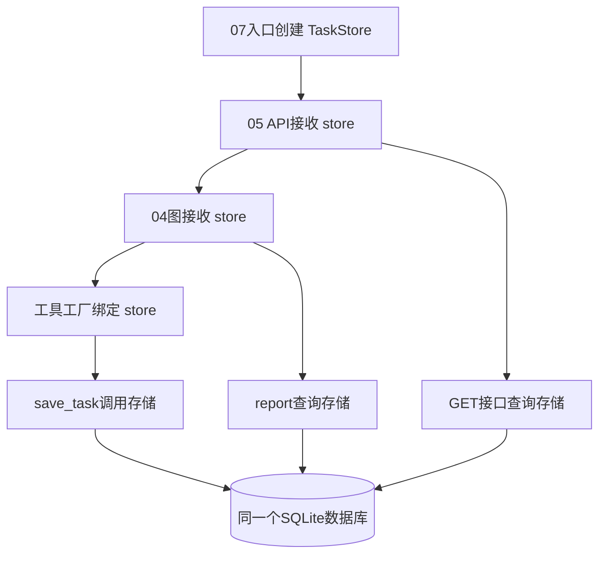

# 第七课：依赖注入，把 SQLite 接回 Agent 与 HTTP

学习记录：用户已新增并验证 `/tasks/pending`，源码确认使用同一注入存储；当前进入 [第八课：Agent查询工具](08_README.md)。下面保留第七课步骤供复习。

## 本次交付和技术位置

现在可以从 HTTP 提交通知，由原有 LangGraph 调用保存工具，将待办写入 SQLite；你添加的 `report` 节点和查询接口也使用同一个存储。

本课的主要技术是**依赖注入**：函数需要一个存储对象时，由调用它的外层代码传入。先用普通 Python 参数掌握这个做法；本课没有新增 FastAPI `Depends`、新 Agent 框架或 checkpoint。

| 文件 | 本课职责 |
| --- | --- |
| [07_sqlite_api.py](07_sqlite_api.py) | 启动入口：创建 `TaskStore` 并传给 API；默认端口8001。 |
| [05_fastapi.py](05_fastapi.py) | 接收可选 `store`；查询和通知处理都复用它。 |
| [04_langgraph.py](04_langgraph.py) | 接收 `store`，提供给工具工厂和用户已有的 `report` 节点。 |
| [assistant_tools.py](assistant_tools.py) | 工具工厂：创建绑定指定存储的 `save_task`。 |
| [03_tool_calling.py](03_tool_calling.py) | 接收工具注册表，校验并执行调用，回传 `ToolMessage`。 |
| [task_store.py](task_store.py) | 延用第六课的 SQL 保存、查询、完成和事务实现。 |

所有新增或修改函数均有中文说明。用户已有的 Prompt、`summary`、`report` 节点和 `/tasks/count` 路由保留。



## 第一步：启动第七课服务

在 `D:\Student_Assistant` 的 PowerShell 中运行：

```powershell
.\.venv\Scripts\python.exe .\lessons\07_sqlite_api.py
```

默认使用 `local-data/assistant.sqlite3`，地址为 `http://127.0.0.1:8001`。等待 `Application startup complete`，保持终端运行。

浏览器打开：

- `http://127.0.0.1:8001/health`：检查服务。
- `http://127.0.0.1:8001/docs`：查看并执行接口。
- `http://127.0.0.1:8001/tasks/count`：全部待办数量。
- `http://127.0.0.1:8001/tasks/pending/count`：未完成待办数量。

新数据库首次创建时没有记录；若该文件之前已保存数据，数量以实际查询为准。第六课演示使用 `lesson06_tasks.sqlite3`，本课不会自动复制演示记录或旧 JSON。

第五课单独启动时仍默认使用端口8000和旧JSON；本课客户端明确连接8001。如果8001已经被占用，使用 `--port 8002`，客户端和浏览器地址也随之调整。

## 第二步：通过原客户端提交一条通知

另开一个终端，运行：

```powershell
.\.venv\Scripts\python.exe .\lessons\05_client.py --base-url http://127.0.0.1:8001
```

默认通知仍包含组会、综述和两篇参考论文的描述。观察：

1. `POST /messages` 返回实际 `tool_results`。
2. 节点顺序通常为 `model → tools → report → model`；模型纠错或追加调用可能增加轮次。
3. `GET /tasks` 返回 SQLite 中的记录，与工具返回的事项一致。
4. 服务端 `report` 打印同一 SQLite 的总数和未完成数量。

接口中的 `execution_status=completed` 表示本次工具执行成功；记录里的 `task.status=pending` 表示这件事还没有做完。两种状态的含义不同。

`/tasks/count` 继续统计全部记录，`/tasks/pending/count` 只统计未完成记录。实际模型可能使用不同标题；当前按完整工具参数生成指纹，还没有实现根据真实消息来源ID的业务去重。

## 第三步：从已知 SQL 工具观察共享数据

从 `/tasks` 复制一条待办的 `id`，将下面的 `实际ID` 替换掉：

```powershell
.\.venv\Scripts\python.exe .\lessons\06_sqlite.py --db .\local-data\assistant.sqlite3 --complete 实际ID
```

重新查询8001上的两个计数接口：全部数量应保持不变，未完成数量应减少1。若该项原本已完成，则未完成数量保持不变。

这里命令行与HTTP服务分别创建自己的存储对象和数据库连接；它们指向同一个数据库文件，所以能读到对方已提交的修改。服务内部则将启动时创建的同一个 `TaskStore` 对象传给各层。

## 关键代码一：外部提供存储

`07_sqlite_api.create_app()` 中的关键两行是：

```python
store = TaskStore(db_path)
api = lesson05.create_app(model_factory=model_factory, store=store)
```

第一行创建存储对象，第二行把对象作为参数交给API。API继续调用：

```python
state = lesson04.run_graph(payload.text, model=model, store=store)
```

这就是依赖注入在本项目中的具体位置：图需要存储，但存储由外层提供。测试时传入临时数据库，正常运行时传入应用数据库，不需要改写模块全局变量。

参数里的 `store: TaskStore | None` 表示可以提供存储，也可以省略以复习旧JSON课程；函数定义中的 `*` 要求后面的参数使用名字传递，例如 `store=store`。

## 关键代码二：工具工厂和闭包

`assistant_tools.py` 的工厂函数接收 `store`，在内部定义同名保存工具，再返回工具注册表。核心结构如下：

```python
def create_task_tools(store: TaskStore) -> dict[str, BaseTool]:
    """为指定存储创建工具表，让不同应用的工具各自使用对应数据库。"""
    @tool("save_task", args_schema=lesson03.SaveTaskInput)
    def save_task(title: str, time_text: str | None = None, location: str | None = None) -> dict:
        """调用外部提供的存储保存待办，并返回实际结果。"""
        return store.save_task(title=title, time_text=time_text, location=location)

    return {save_task.name: save_task}
```

这里外层返回后，内部工具仍能使用传进来的 `store`，这是闭包的作用。“工具工厂”就是负责创建这些工具的普通函数；先理解参数怎样流动，不需要记复杂定义。

模型只看到标题、时间原话、地点等工具输入；数据库路径由启动代码决定。`bind_tools(list(registry.values()))` 与 `execute_tool_call(call, registry=registry)` 共用同一工具表，保证模型看到的可用工具和程序真正执行的工具一致。未注册名称会返回错误。[LangChain 官方工具说明](https://docs.langchain.com/oss/python/langchain/tools)

## 当前练习：换一个数据库，预测数量

先完成上面的运行和查询。随后用 Ctrl+C 停止本课8001服务，再运行：

```powershell
.\.venv\Scripts\python.exe .\lessons\07_sqlite_api.py --db .\local-data\lesson07_practice.sqlite3
```

**先预测，再查询 `/tasks/count`：如果这个文件从未存在过，数量应该是多少？** 注意先查询，再发送通知；若提前运行客户端，就已经向新数据库保存了事项。

然后思考：为什么只修改 `--db`，保存工具和 `report` 的函数体都不需要修改？请结合 `TaskStore(db_path)`、`store=store` 这两行解释。这个练习验证的是依赖如何传递，SQL不会因为换数据库文件就自动变成另一个引擎。

练习结束后，重新启动默认命令即可回到 `assistant.sqlite3`。数据库文件保留，切换路径不会删除原记录。

用户已反馈新数据库的查询数量为0，并解释：路径由创建存储对象时的参数决定，保存工具通过传入对象调用 `save_task()`，不需要自己知道路径。这体现了对象参数传递与依赖注入的概念理解；接下来通过新增接口练习实际使用它。

## 下一练习：通过同一存储查询未完成列表

打开 `07_sqlite_api.py`，在 `create_app()` 的 `return api` 之前加入下面的路由。装饰器与已有的 `/tasks/pending/count` 保持同一级缩进。用户现已按该示例加入源码并反馈校对成功，下方代码保留供复习。

```python
    @api.get("/tasks/pending", summary="查询未完成待办列表")
    def get_pending_tasks() -> dict:
        """使用创建应用时提供的存储查询未完成列表，不调用模型。"""
        try:
            # 路由使用已有存储对象，SQL 筛选由 TaskStore.list_tasks 负责。
            tasks = store.list_tasks(status="pending")
            return {"count": len(tasks), "tasks": tasks}
        except (OSError, ValueError, sqlite3.Error):
            raise HTTPException(status_code=500, detail="未完成待办查询失败，请检查服务端数据。") from None
```

这里复用了 FastAPI 路由、Python 字典与依赖注入；`store` 就是外层 `create_app()` 创建并传给其他接口和图的存储对象。

保存后在服务端终端按 Ctrl+C，再用原来的启动命令重启，保持同一个 `--db` 路径。访问 `http://127.0.0.1:8001/tasks/pending`，核对：

1. `tasks` 中每条记录的 `status` 都是 `pending`。
2. `count` 等于列表条目数，也等于 `/tasks/pending/count` 返回的数量。

如果数据库为空，应返回 `{"count":0,"tasks":[]}`。你也可以用第五课客户端向8001提交通知，再查询，观察实际记录。请完成新增路由与重启查询后反馈结果；看过示例不等于已完成这次代码练习。

## 可选：明确导入旧 JSON

需要保留第三课数据时，在启动本课服务前使用：

```powershell
.\.venv\Scripts\python.exe .\lessons\07_sqlite_api.py --import-json
```

省略路径时读取第三课 `local-data/lesson03_tasks.json`；也可以在参数后指定同结构JSON。原文件不修改。输入错误或ID内容冲突会停止启动，避免把失败误当成迁移成功；重复导入保留已有完成状态。这是一次导入，不会在后台监视旧JSON的后续变化。

## 错误、事务与当前范围

SQLite 操作各自创建并关闭连接，事务只覆盖本次数据库操作；模型网络请求不占着数据库事务。旧JSON模式仍使用原有进程内锁。本课尚未加入跨多个模型/工具步骤的整体事务或回滚；模型超时、后续节点失败时，此前已提交的事项仍可通过 `/tasks` 查询。

非法工具参数与工具数据库错误通过 `ToolMessage` 回传，HTTP的 `execution_status` 按实际工具结果判断；数据库查询异常返回HTTP500，避免把内部错误原样暴露。

这次接入只统一了待办存储，尚未实现完整原消息表、来源ID去重、角色配置、附件下载、精确时间、提醒调度或跨运行图恢复；完整上游服务与界面也尚未启动。

## 验证与资料

本课7项集成测试与第三至第六课29项回归测试已通过，共36项。测试使用模拟模型、真实图和临时SQLite；进程内接口测试不等于真实外部模型调用。

2026-10-15还通过了本机TCP服务、真实DeepSeek与临时SQLite的联合验证：`POST /messages` 返回200/completed，路径为model/tools/report/model，两项工具保存成功；总数和未完成数量均为2。另一个第六课CLI进程完成一项后，服务查询未完成数量变为1，总数保持2；空白正文返回422。关闭验证服务后重新打开数据库，记录仍保留，旧JSON内容未改变。完整运行结果见 [results/07_example.json](results/07_example.json)。临时验证服务已停止，使用本讲义命令启动你自己的服务。

```powershell
.\.venv\Scripts\python.exe -X utf8 -m unittest discover -s lessons -p "test_07_sqlite_api.py" -v
```

关于Python作用域与闭包，可参考 [Python作用域与命名空间](https://docs.python.org/3.13/tutorial/classes.html#python-scopes-and-namespaces)；FastAPI自己的 `Depends` 注入系统见 [官方文档](https://fastapi.tiangolo.com/tutorial/dependencies/)，后续需要请求级资源管理时再学习。
